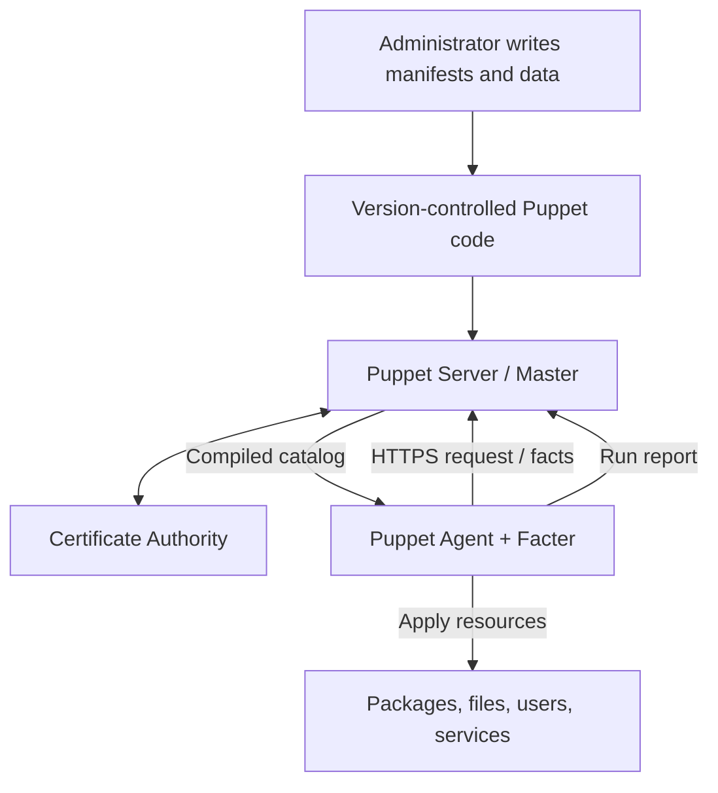

# Unit I — Puppet Basics

> **Syllabus unit:** Puppet Basics<br>
> **Course:** INT333 — DevOps Advance Configuration Management (Session 2026–27)

## 1. Learning objectives

After studying this unit, you should be able to explain configuration management, compare push and pull approaches, describe Puppet and its components, draw the Puppet Master–Agent architecture, identify manifests, templates, files and the Certificate Authority, explain the roles of Agent and Facter, and describe installation and isolated Puppet development.

## 2. Configuration management system

**Configuration management (CM)** is the systematic process of defining, applying, maintaining and auditing the desired configuration of systems. A configuration can include installed packages, users, groups, services, directories, files, permissions and application settings.

Without CM, administrators often configure machines manually. Over time, machines drift: one server has a different package version, another has a missing file, and a third has a service disabled. Configuration management reduces this drift by expressing the desired state in code and applying it consistently.

### Why configuration management is useful

- **Consistency:** machines can be configured using the same definitions.
- **Repeatability:** the same configuration can be applied again.
- **Idempotency:** applying an already-satisfied desired state should not make unnecessary changes.
- **Auditability:** configuration changes can be reviewed and version-controlled.
- **Scale:** the same policy can be applied to many machines.
- **Recovery:** a tool can restore a resource when it drifts from the declared state.

Configuration management is not the same as simply running a long shell script. A CM tool models resources and their desired properties, tracks whether those properties are satisfied, and reports changes.

## 3. Push and pull configuration models

### Push model

In a push model, a central controller or operator initiates a connection and sends configuration or commands to managed nodes.

**Typical flow:** Controller → managed node → configuration applied → result returned.

Advantages include immediate, centrally initiated execution and straightforward control over when an operation starts. Limitations include the need for the controller to reach the nodes and the need to manage credentials and connectivity.

### Pull model

In a pull model, a managed node periodically contacts a central service, retrieves its assigned configuration, and applies it locally.

**Typical flow:** Agent on node → configuration server → catalog/policy returned → agent applies it → report sent.

Advantages include nodes initiating their own connection and periodically reconciling their state. The central server does not have to initiate a connection to every agent. A limitation is that a change may not be applied until the next agent run unless an immediate run is triggered.

| Aspect | Push | Pull |
|---|---|---|
| Who initiates? | Controller | Managed node/agent |
| Typical timing | Controller-selected | Periodic or agent-triggered |
| Connectivity | Controller must reach target | Agent must reach controller |
| Common use | Orchestrated commands/configuration | Continuous desired-state reconciliation |

Puppet commonly uses an agent-based pull workflow in a Master–Agent deployment. Puppet can also be used locally with `puppet apply` for isolated development.

## 4. Introduction to Puppet

**Puppet** is a configuration management tool. Administrators describe the target state of system resources in Puppet code. Puppet evaluates that description and takes actions required to make the system match the desired state.

For example, a policy may state that a package must be installed, a configuration file must contain a particular value, and a service must be running. Puppet checks the current system and makes changes when necessary.

### Why Puppet?

- Declarative descriptions focus on *what state is required* rather than every imperative step.
- Resource abstractions make common system administration tasks manageable.
- Manifests and modules can be version-controlled and reused.
- Puppet can manage many machines through a central server.
- Repeated application supports state convergence and drift correction.

## 5. Puppet architecture and components

A conventional Puppet deployment has a **Puppet Server (Master)** and one or more **Puppet Agents (Clients)**.



### Puppet Master / Server

The central Puppet service receives requests from agents, uses node information and Puppet code to compile a catalog, and returns the catalog to the requesting agent. In older material and common course terminology this central component is called the **Puppet Master**; current product documentation commonly uses **Puppet Server**.

### Manifest

A **manifest** is a Puppet source file, conventionally using the `.pp` extension. It contains resource declarations, classes, relationships and other Puppet language constructs. Manifests describe desired configuration.

Example:

```puppet
file { '/etc/autoops-example':
  ensure => directory,
  mode   => '0755',
}
```

This example declares that a directory should exist with the specified permissions. It does not describe a sequence of shell commands to create it.

### Template

A **template** is a reusable file containing fixed text and dynamic placeholders. Puppet templates allow configuration files to be generated using data such as variables, facts or class parameters. Puppet supports Embedded Puppet (EPP) templates and ERB templates.

Simplified EPP example:

```epp
service_port = <%= $port %>
service_name = <%= $service_name %>
```

The values are supplied by the Puppet code that renders the template. A template should be validated and tested with representative data.

### Files

Puppet can manage files and directories: whether they exist, their content, ownership and permissions. A file resource can use inline content, a source file or rendered template content. File ownership should be deliberate; multiple automation tools should not compete to manage the same file.

### Certificate Authority (CA)

The Puppet CA manages agent/server certificates and trust. In a typical first connection, an agent generates or uses a certificate request, the CA signs/authorizes it according to the configured workflow, and the agent and server use trusted certificates for authenticated TLS communication.

Important terms:

- **Certificate request:** an agent asks to be recognized by the Puppet server.
- **Signing:** the CA approves and signs the certificate request.
- **Certificate:** identity material used for trusted communication.
- **Revocation:** invalidates a certificate that should no longer be trusted.

Do not sign unknown requests without confirming the requesting node's identity.

## 6. Puppet Clients: Agent and Facter

### Puppet Agent

The **Puppet Agent** runs on a managed node. It gathers local information, contacts the Puppet server, receives a compiled catalog, applies the resources, and reports the run result.

A typical agent run is initiated with:

```bash
sudo puppet agent --test
```

This command is for a configured agent/server environment. It is not a substitute for `puppet apply` in a standalone manifest exercise.

### Facter

**Facter** gathers facts about a system, such as operating system, hostname, architecture, IP addresses and memory. Puppet code can use facts to make configuration dynamic.

Example command:

```bash
facter
facter os
facter networking
```

Fact names and available values depend on the installed Facter version and platform. Inspect the actual output rather than assuming every fact exists on every machine.

## 7. Installation of Puppet

The syllabus includes Puppet installation. Exact installation steps depend on the Linux distribution and supported Puppet release. On Ubuntu, first inspect the environment and available package sources:

```bash
cat /etc/os-release
apt-cache policy puppet
puppet --version
```

If Puppet is absent, follow the installation method specified by the instructor or the official Puppet documentation for the target Ubuntu release. Do not mix repositories or install an arbitrary package version without checking compatibility.

After installation, verify the executable:

```bash
puppet --version
puppet help
```

For a managed server/agent lab, server and agent setup requires additional configuration, hostname resolution, network access and certificate enrollment. For a first local exercise, an isolated `puppet apply` workflow is simpler.

## 8. Puppet development in isolation

Puppet can be tested locally without a Puppet Master by using `puppet apply`. This is useful for learning manifests and testing resource declarations in a disposable VM or controlled environment.

Create a file named `hello.pp`:

```puppet
file { '/tmp/puppet-learning':
  ensure  => directory,
  mode    => '0755',
}

file { '/tmp/puppet-learning/message.txt':
  ensure  => file,
  content => "Managed by Puppet.\\n",
  mode    => '0644',
  require => File['/tmp/puppet-learning'],
}
```

Validate and apply:

```bash
puppet parser validate hello.pp
puppet apply --noop hello.pp   # preview planned changes
sudo puppet apply hello.pp     # apply to the local machine
sudo puppet apply hello.pp     # repeat to inspect idempotency
```

The `/tmp` path is used for a low-risk learning example. Even local manifests can change the host; read the manifest before running it with elevated privileges.

## 9. Key terms

| Term | Meaning |
|---|---|
| Configuration management | Maintaining systems in a defined, known configuration |
| Desired state | The configuration the system is expected to satisfy |
| Push | Controller initiates configuration delivery |
| Pull | Managed node retrieves its configuration |
| Puppet Server/Master | Central service that compiles catalogs |
| Agent | Client that requests and applies catalogs |
| Manifest | Puppet code file describing resources |
| Catalog | Compiled set of resources and relationships for a node |
| Template | Reusable dynamic configuration-file source |
| CA | Certificate Authority that manages trust and certificates |
| Facter | Tool that gathers system facts |
| Idempotency | Repeated application does not cause unnecessary changes |

## 10. Quick revision questions

1. Define configuration management and state three benefits.
2. Differentiate push and pull models with a flow diagram.
3. What is Puppet, and why is it used?
4. Explain the role of the Puppet Server/Master.
5. What is a manifest? Give a simple resource example.
6. Differentiate a manifest and a template.
7. What is the purpose of the Puppet Certificate Authority?
8. Explain the role of Puppet Agent and Facter.
9. What is a catalog?
10. How can Puppet be developed and tested without a Master?

## 11. Practical connection

This unit supports practicals 1–3: setting up a virtualization environment, installing Puppet, and creating/applying basic manifests. See [Practical Experiments](../practicals/experiments.md).

---

**Syllabus coverage:** Configuration Management System; Configuration Management; Pull and Push; Introduction to Puppet; Why Puppet; Components; Puppet Architecture; Puppet Master; Manifest; Template; Files; Certificate Authority; Puppet Clients; Agent; Facter; Installation of Puppet; Puppet Development in Isolation.
