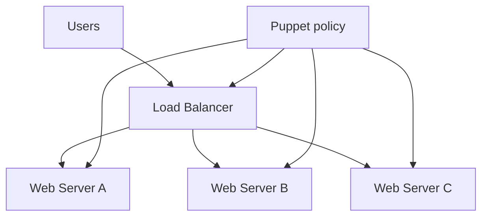

# Unit II — Advanced Puppet

> **Syllabus unit:** Advanced Puppet<br>
> **Course:** INT333 — DevOps Advance Configuration Management (Session 2026–27)

## 1. Learning objectives

This unit develops the foundations from Unit I. You should be able to configure Puppet, manage packages and modules, understand web-server and load-balancing configuration, scale Puppet environments, connect agents to a Master, use facts and templates for dynamic configuration, understand extensions, classes and functions, use Puppet command-line tools, apply resources with `puppet apply`, and write manifests.

## 2. Puppet configuration

Puppet behavior is controlled by configuration settings. Settings can define the server, environment, certificate identity, module paths, run intervals, logging and other runtime behavior. Configuration locations and available settings vary by Puppet version and deployment model.

Useful inspection commands:

```bash
puppet config print
puppet config print server
puppet config print environment
puppet config print modulepath
```

For an agent/server deployment, verify name resolution, server reachability, certificate identity and environment configuration before running an agent. Avoid copying configuration values from another machine without understanding what they mean.

## 3. Managing packages in Puppet

A package resource describes the desired package state. The provider uses the host's package-management system, such as APT or RPM, to carry out the change.

Example:

```puppet
package { 'curl':
  ensure => installed,
}
```

Common package states include `installed`, `absent`, and, where supported, a specific version. Package names and available versions differ across distributions.

A package declaration should not be used blindly on a production machine: installing or removing software may alter dependencies or services. Review the plan and test on a disposable system first.

## 4. Puppet modules

A **module** is a reusable, structured collection of Puppet code, files, templates and metadata. Modules organize related configuration and allow teams to reuse tested functionality.

Typical module layout:

```text
autoops_policy/
├── manifests/
│   └── init.pp
├── files/
├── templates/
│   └── service.conf.epp
└── metadata.json
```

- `manifests/`: classes and defined resource types.
- `files/`: static files that can be distributed.
- `templates/`: dynamic templates.
- `metadata.json`: module metadata and dependencies.

A class can be declared from a site manifest. Keep module scope focused and avoid creating one huge class that manages unrelated services.

## 5. Monitoring web servers with Puppet

Puppet can configure the components that make a web server run consistently. A conceptual configuration may manage:

1. Web-server package is installed.
2. Site configuration file is present with expected content.
3. Document root has appropriate ownership and permissions.
4. Service is enabled and running.
5. Configuration changes trigger a service reload or restart when appropriate.

Example pattern:

```puppet
package { 'nginx':
  ensure => installed,
}

file { '/etc/nginx/conf.d/example.conf':
  ensure  => file,
  content => "server { listen 8081; }\\n",
  require => Package['nginx'],
  notify  => Service['nginx'],
}

service { 'nginx':
  ensure    => running,
  enable    => true,
  subscribe => File['/etc/nginx/conf.d/example.conf'],
}
```

This is an illustrative relationship pattern, not a complete Nginx production configuration. Validate syntax and test the configuration before reloading a real service.

**Important distinction:** Puppet configures the web server. Nagios (Unit III) monitors its runtime condition. Configuration management and monitoring complement each other but are not the same task.

## 6. Load-balancing clusters

A load balancer distributes incoming requests across multiple backend servers. Puppet can help keep the load-balancer package, configuration, backend definitions and service state consistent across environments.

Conceptual topology:



Puppet does not automatically create a correct high-availability design merely because a manifest exists. Health checks, session behavior, capacity, TLS, failure domains and the load balancer's actual software configuration must be designed and tested.

## 7. Scaling a Puppet environment

Scaling means managing more nodes, teams, environments and configuration changes reliably. Useful design practices include:

- Reusable, focused modules.
- Separate development, test and production environments.
- Version-controlled code and reviewed changes.
- Clear node classification and data separation.
- Controlled module dependencies and releases.
- Monitoring of agent runs and failed catalog applications.
- Certificate and access-management discipline.

Do not assume that adding more agents is only a CPU problem. Network capacity, catalog compilation, module quality, change coordination and certificate operations also matter.

## 8. Connecting a Puppet Agent with a Puppet Master

A high-level agent enrollment process is:

1. Configure the Puppet server name and environment on the agent.
2. Ensure the server name resolves from the agent.
3. Confirm required network connectivity and time synchronization.
4. Run the agent to submit a certificate request.
5. Verify the request identity on the CA/server.
6. Approve/sign the correct certificate.
7. Run the agent again and inspect the catalog application report.

Illustrative commands (exact options can vary by version):

```bash
# On the agent: submit/request a certificate and run
sudo puppet agent --test

# On the server: inspect requests, then sign the verified node
sudo puppetserver ca list
sudo puppetserver ca sign --certname <verified-agent-certname>
```

Never sign a request just because it appeared. Confirm the hostname and identity first. A certificate is a trust decision.

## 9. Making configuration dynamic

Static configuration uses fixed values. Dynamic configuration derives values from parameters, node data, or facts.

For example, a template may render a service port and hostname using class parameters. Facter can provide operating-system or network data. Hiera is commonly used to separate configuration data from code, although the supplied syllabus specifically names facts and templates in this section.

Illustrative class and EPP use:

```puppet
class autoops_policy(
  Integer $port = 5000,
  String  $service_name = 'autoops',
) {
  file { '/etc/autoops/service.conf':
    ensure  => file,
    content => epp('autoops_policy/service.conf.epp', {
      'port'         => $port,
      'service_name' => $service_name,
    }),
    mode    => '0644',
  }
}
```

Template:

```epp
service_name = <%= $service_name %>
port = <%= $port %>
```

Validate parameter types and template rendering. A wrong dynamic value can generate an invalid configuration even when the manifest parses.

## 10. Extending Puppet

Puppet can be extended through reusable modules, custom resource types/providers, functions and integrations. Extensions should solve a real need and be tested against the Puppet version in use.

An extension should have:
- A defined responsibility and interface.
- Input validation and predictable output.
- Tests for normal and error cases.
- Version compatibility information.
- Documentation and an ownership boundary.

The syllabus includes extending Puppet; the exact extension mechanism chosen depends on the lab requirement and installed Puppet release.

## 11. Puppet classes and functions

### Classes

A **class** is a named block of Puppet code used to group related resources and parameters. Classes help organize configuration into reusable units.

```puppet
class webserver {
  package { 'nginx': ensure => installed }
  service { 'nginx': ensure => running, enable => true }
}
```

Class declarations and resource relationships should be designed so dependencies are explicit and duplicate declarations are avoided.

### Functions

A **function** evaluates input and returns a value for use in Puppet expressions. Built-in functions help manipulate strings, arrays, hashes and data. The syllabus also includes custom functions.

A conceptual custom-function example should be implemented using the extension API supported by the installed Puppet version. Function APIs have evolved; do not copy legacy examples without checking compatibility. For learning, first understand function inputs, return values, scope and validation.

## 12. Using Puppet via the command line

Common commands include:

```bash
puppet --version
puppet help
puppet config print
puppet parser validate site.pp
puppet resource service nginx
puppet resource package curl
puppet module list
```

The `puppet resource` command can inspect or manage resource state. Treat commands that change state with the same care as direct system administration.

## 13. Managing resources with `puppet apply`

`puppet apply` applies a local manifest to the current machine, without requiring a central Puppet Server for that local run.

```bash
puppet parser validate site.pp
puppet apply --noop site.pp
sudo puppet apply site.pp
sudo puppet apply site.pp
```

- Validation checks manifest syntax.
- `--noop` previews proposed resource changes without applying them.
- A normal apply enforces the manifest.
- A repeated apply is useful for checking idempotency.

A no-op run does not prove that the live change succeeds. Test both a preview and a controlled live application where safe.

## 14. Puppet manifests — design checklist

A good manifest should:

- Declare desired state clearly.
- Use meaningful resource titles.
- Specify required ownership and permissions.
- Use dependencies and notifications deliberately.
- Avoid duplicate resource declarations.
- Separate data from logic where practical.
- Be formatted and validated.
- Be safe to apply repeatedly.
- Have a test plan and rollback/recovery approach.

## 15. Quick revision questions

1. What is a Puppet module? Draw its directory structure.
2. How does Puppet manage package installation?
3. Explain how Puppet can configure a web server.
4. How can Puppet help maintain a load-balancing cluster?
5. What issues appear when scaling Puppet environments?
6. Explain Puppet Agent–Master certificate enrollment.
7. How do facts and templates make configuration dynamic?
8. What are Puppet classes and functions?
9. Differentiate `puppet apply` and `puppet agent`.
10. Explain the purpose of `--noop` and why it is not a substitute for a live test.

## 16. Practical connection

This unit supports practicals 4–6 and the Puppet portions of practical 15: custom module creation, Master–Agent setup, and dynamic resource management.

---

**Syllabus coverage:** Puppet Configuration; Package Management; Modules; Monitoring Web Servers; Load Balancing Clusters; Scaling Puppet; Agent–Master Connection; Dynamic Configuration; Extending Puppet; Classes and Functions including Custom Functions; Command Line; `puppet apply`; Manifests.
