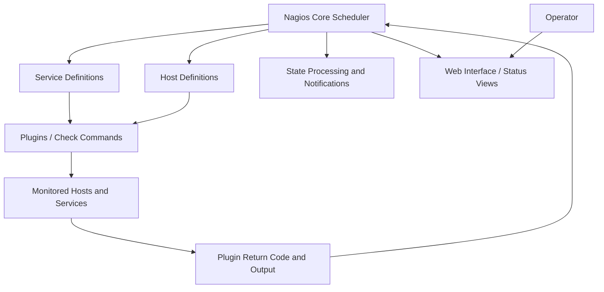

# Unit III — Nagios Monitoring

> **Syllabus unit:** Nagios Monitoring<br>
> **Course:** INT333 — DevOps Advance Configuration Management (Session 2026–27)

## 1. Learning objectives

After this unit, you should be able to define continuous monitoring, explain its importance and benefits, describe Nagios features and architecture, explain plugins and soft/hard states, outline installation approaches, understand prerequisites and web-server setup, use command-line interfaces, configure web-server monitoring, and work with the Nagios web interface to manage hosts, services, downtimes, comments and information.

## 2. Continuous monitoring

**Continuous monitoring** is the ongoing collection and evaluation of system or service health information so that operational problems can be detected and investigated promptly.

Monitoring can observe:
- Host availability and reachability.
- Service availability, such as HTTP or SSH.
- Application response codes and response time.
- Resource utilization such as CPU, memory and disk.
- Logs and application-specific health indicators.

### Importance and benefits

- Detects service failures and degraded behavior.
- Provides operational visibility.
- Helps teams respond before minor faults become larger incidents.
- Produces historical evidence for troubleshooting and capacity planning.
- Supports service-level objectives when metrics and alert thresholds are designed appropriately.

Monitoring does not prevent every failure. It detects signals and helps operators respond. A monitoring system can itself fail, so its availability and alert delivery should also be considered.

## 3. Introduction to Nagios

**Nagios** is an infrastructure and service monitoring system. Nagios Core uses host and service definitions together with plugins to check targets and report their states. It provides status information through its web interface and operational commands.

### Features commonly associated with Nagios

- Host and service monitoring.
- Plugin-based checks.
- Configurable check intervals and retry behavior.
- State changes and notifications.
- Web-based status views.
- Comments, acknowledgements and scheduled downtimes.
- Extensibility through custom scripts/plugins.

Exact capabilities and interface details depend on the Nagios product edition, Core version and installed plugins.

## 4. Nagios architecture



Key concepts:

- **Nagios Core:** schedules checks, processes results and maintains monitoring states.
- **Host:** a monitored machine or endpoint representing a target.
- **Service:** a specific check associated with a host, such as HTTP availability.
- **Plugin:** executable that performs the check and returns a status code with text output.
- **Command definition:** connects a Nagios check command to a plugin and its arguments.
- **Notification:** alert mechanism for relevant state changes, depending on configuration.
- **Web interface:** displays host/service states and operational information.

## 5. Plugins

A **Nagios plugin** is an executable check program. It examines a target and returns both human-readable output and a status code.

The standard plugin exit-code convention is:

| Exit code | State | Meaning |
|---:|---|---|
| 0 | OK | Check succeeded; condition is within acceptable limits |
| 1 | WARNING | Check succeeded but a warning threshold was crossed |
| 2 | CRITICAL | Check found a critical problem |
| 3 | UNKNOWN | Check could not determine a reliable state |

The plugin output should explain the result and, where applicable, include performance data. A plugin should have a timeout, validate its inputs and avoid leaking credentials.

### Example: simple HTTP check using a standard plugin

A command-line test can be performed using `curl`:

```bash
curl -i --max-time 5 http://127.0.0.1:5000/health
```

This is a connectivity test, not a Nagios plugin invocation. Nagios must be configured to call a plugin from its own execution environment. If Nagios runs in a container, the plugin must exist inside that container or be provided through a custom image.

## 6. Soft and hard states

Nagios uses **soft** and **hard** states to manage check retries and state transitions.

- A **soft state** is generally a non-OK result during the retry period. Nagios performs configured retries to determine whether the problem is persistent.
- A **hard state** is the confirmed state after the configured retry logic is completed, or a state transition that meets the system's hard-state rules.

The retry strategy helps reduce alerts caused by brief or transient issues. It also introduces detection delay. The check interval, retry interval and maximum check attempts should be selected with the service's importance and acceptable detection time in mind.

Conceptual example: if a service fails once, Nagios records a soft problem and retries. If it continues failing through the configured attempts, the service reaches a hard CRITICAL state and configured notifications may be sent.

## 7. Installation of Nagios

The syllabus lists installation using package managers such as `apt-get`/`dpkg` and `yum`/`rpm`, installing prerequisites, compiling and installing, setting up a web server, and using command-line interfaces.

### Before installing

Inspect the target distribution and package availability:

```bash
cat /etc/os-release
apt-cache policy nagios4 nagios-nrpe-server nagios-plugins
```

Package names vary between distributions and repositories. On RPM-based systems, the package manager and package names differ. Use the instructions appropriate for the actual operating system and course lab image.

### Package-manager approach

A package manager can install Nagios and its dependencies, manage updates and track installed files. This is generally easier to reproduce than manual compilation where supported packages are available.

### Compile-and-install approach

A source build typically requires build tools and web-server/development prerequisites. The broad sequence is:

1. Install prerequisites.
2. Obtain the appropriate source release.
3. Configure build options.
4. Compile.
5. Install binaries and sample configuration.
6. Configure service accounts and permissions.
7. Configure the web server and authentication.
8. Validate configuration and start services.

Exact commands and paths depend on the selected Nagios Core release and platform. Follow the matching installation guide rather than mixing steps from different versions.

### Web server setup

Nagios Core's traditional web interface is commonly served through a supported web server with CGI support and authentication configuration. Confirm which web server and CGI components the selected installation method expects. Do not expose an unauthenticated monitoring interface to an untrusted network.

## 8. Nagios configuration fundamentals

Nagios configuration describes hosts, services, commands, contacts, time periods and other monitoring behavior. Configuration is commonly divided into files so that host/service definitions and command definitions can be maintained clearly.

Conceptual service-definition fields include:

- Host association.
- Service description.
- Check command and arguments.
- Check interval and retry interval.
- Maximum check attempts.
- Notification settings.

The actual directive names and syntax must match the installed Nagios Core version. Validate configuration before reloading/restarting Nagios.

## 9. Monitoring web servers

A web-server check should test the behavior that matters. A basic HTTP availability check might verify:

- Target host can be reached.
- TCP connection to the expected port succeeds.
- HTTP endpoint returns an expected status code.
- Optional response content matches an expected value.
- Optional response time remains below a threshold.

Example manual checks:

```bash
curl -sS -o /dev/null -w 'HTTP %{http_code} total=%{time_total}s\\n' \
  --max-time 5 http://127.0.0.1:5000/health
```

For a Docker network, use the application service/container DNS name from the monitoring container's network, for example `http://autoops-app:5000/health`, only after verifying that name resolution and network attachment work.

Do not use `127.0.0.1` inside the Nagios container to mean the application container. In a container, `127.0.0.1` refers to that same container.

## 10. Nagios web interface

The syllabus expects use of the built-in web interface for:

- **Hosts:** view the state and information for monitored machines.
- **Services:** inspect individual checks and their state histories.
- **Downtimes:** schedule a known maintenance period so expected service interruptions are handled appropriately.
- **Comments:** record context for an issue or maintenance activity.
- **Information:** inspect status details, check results and related operational data.

The precise menu names and available functions may differ between releases or distributions. Learn the interface installed in your lab.

### Operational workflow

1. Open the Nagios dashboard using the configured URL.
2. Locate the target host and service.
3. Inspect the current state and latest plugin output.
4. Acknowledge or comment on an incident where appropriate.
5. Schedule downtime before planned maintenance.
6. Verify that the service returns to OK after maintenance or recovery.

## 11. Deploying a simple web application on a server

The syllabus includes deploying a simple web application as part of the monitoring practical. The purpose is to create a real service target for monitoring.

A minimal workflow is:

1. Build or install the sample application.
2. Start it as a service or container.
3. Expose a known HTTP endpoint.
4. Test it locally with `curl`.
5. Configure Nagios to check the endpoint.
6. Introduce a controlled failure in a lab.
7. Confirm Nagios detects the failure and later recovery.

A successful monitoring demonstration requires both a healthy check and a failed check. A dashboard screenshot alone does not prove that failure detection works.

## 12. Quick revision questions

1. Define continuous monitoring and explain its benefits.
2. Draw and explain Nagios architecture.
3. What is a Nagios plugin? Explain the four standard return codes.
4. Differentiate soft and hard states.
5. Explain package-based and source-based installation approaches.
6. Why does Nagios need a web server/interface setup?
7. How would you monitor an HTTP service?
8. What are hosts and services in Nagios?
9. Explain downtime and comments in the web interface.
10. Describe a complete failure-detection and recovery test for a web application.

## 13. Practical connection

This unit supports practicals 7–10: Nagios Core installation, custom plugin development, web-server monitoring and use of the web interface.

---

**Syllabus coverage:** Continuous Monitoring definition, importance and benefits; Nagios features, architecture, plugins, soft and hard states; package/source installation; prerequisites; web-server setup; CLI; configuration; web-server monitoring; web interface; hosts, services, downtimes, comments, information; deployment of a simple web application.
