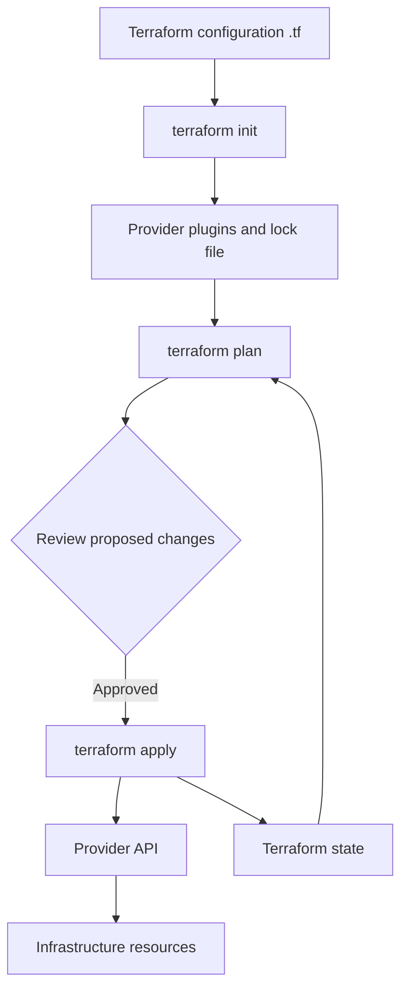
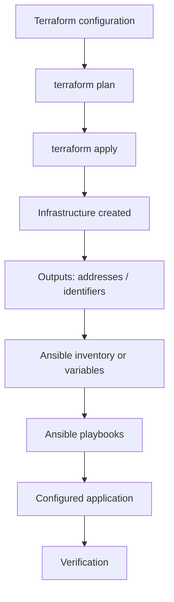

# Unit IV — Infrastructure as Code with Terraform

> **Syllabus unit:** Infrastructure as Code with Terraform<br>
> **Course:** INT333 — DevOps Advance Configuration Management (Session 2026–27)

## 1. Learning objectives

By the end of this unit, you should be able to define Terraform and Infrastructure as Code (IaC), explain benefits and use cases, describe Terraform architecture and workflow, install and configure Terraform, write configuration files, understand cloud provisioning on AWS/Azure/GCP, manage resources and dependencies, explain state, modules and workspaces, describe Terraform integration with Ansible, and apply best practices and security considerations.

## 2. What is Infrastructure as Code?

**Infrastructure as Code (IaC)** is the practice of defining infrastructure through machine-readable configuration files rather than relying only on manual operations through a graphical console.

Infrastructure may include virtual machines, networks, subnets, security rules, storage, load balancers, DNS records and managed services. IaC makes infrastructure definitions reviewable, repeatable and suitable for version control.

### Benefits and use cases

- Repeatable creation of environments.
- Reviewable infrastructure changes.
- Reduced manual configuration drift.
- Easier reuse through modules.
- Consistency across development, test and production.
- A record of intended infrastructure configuration.

IaC does not automatically guarantee security or correctness. A configuration can reproduce an insecure design just as consistently as a secure one. Plans, policies, reviews and tests remain essential.

## 3. Introduction to Terraform

**Terraform** is an IaC tool that reads declarative configuration, builds a dependency graph and interacts with infrastructure providers to create, update or destroy resources.

Terraform uses providers to communicate with platforms and services. Examples include cloud providers for AWS, Azure and Google Cloud, as well as providers for other infrastructure APIs.

### Benefits and use cases

- Declarative infrastructure definitions.
- Dependency-aware execution.
- Change planning before application.
- Reusable modules.
- State tracking.
- Multi-environment workflows through workspaces and configuration/data separation.

## 4. Terraform architecture and workflow



### Main workflow commands

1. `terraform init` — initializes the working directory and downloads provider/module dependencies.
2. `terraform fmt` — formats Terraform configuration.
3. `terraform validate` — validates configuration structure and internal consistency.
4. `terraform plan` — compares configuration and current state/remote objects to propose changes.
5. `terraform apply` — executes an approved plan.
6. `terraform destroy` — proposes/removes resources managed by the selected configuration and state; this is destructive and requires careful review.

Never run `apply` or `destroy` blindly. Read the proposed actions and confirm the workspace and state backend first.

## 5. Installing and setting up Terraform

Installation depends on the operating system and the approved distribution method. Verify the binary and version after installation:

```bash
terraform version
terraform -help
```

A Terraform project commonly contains:

```text
terraform-project/
├── versions.tf
├── main.tf
├── variables.tf
├── outputs.tf
└── terraform.tfvars.example
```

- `versions.tf`: required Terraform/provider version constraints and provider declarations.
- `main.tf`: resources, data sources and module calls.
- `variables.tf`: configurable inputs.
- `outputs.tf`: values exposed after apply.
- `terraform.tfvars.example`: non-secret example values. Real secret values should not be committed.

The `.terraform.lock.hcl` file records selected provider versions and checksums. Commit it for reproducibility in a root module where appropriate.

## 6. Writing and managing configuration files

Terraform configuration uses HashiCorp Configuration Language (HCL). Common blocks include:

- `terraform`: settings and required providers.
- `provider`: provider configuration.
- `resource`: infrastructure object managed by Terraform.
- `data`: read an existing object without managing it as a resource.
- `variable`: declare an input.
- `output`: expose a result.
- `module`: reuse a collection of Terraform configuration.

Illustrative configuration shape:

```hcl
terraform {
  required_version = ">= 1.5.0"
  required_providers {
    docker = {
      source  = "kreuzwerker/docker"
      version = "~> 3.0"
    }
  }
}

provider "docker" {}
```

This is only a provider declaration example. A working configuration requires a compatible provider, Docker API connectivity and resource definitions that match the provider schema and local runtime. Do not treat a provider example as universally compatible.

### Variables

Variables allow users to supply values without editing resource logic. Give variables descriptions and types; use validation where appropriate. Avoid storing secrets in plain-text variable files or committing secret values.

### Outputs

Outputs publish useful values such as resource identifiers, addresses or names. Outputs may reveal sensitive information, so mark and protect sensitive outputs appropriately.

## 7. Provisioning infrastructure on AWS, Azure and GCP

The syllabus names AWS, Azure and Google Cloud Platform (GCP) as provisioning targets. A typical cloud workflow is:

1. Create or select an account/project and choose a region.
2. Configure credentials using an approved identity mechanism.
3. Declare provider and required resources.
4. Define network, security and dependency relationships.
5. Review the plan for cost, exposure and destructive changes.
6. Apply the approved plan.
7. Verify deployed resources.
8. Manage state and lifecycle carefully.

Cloud resources can incur charges. Use a budget, least-privilege identity and a disposable lab environment. Never paste access keys into source code or screenshots.

For a local-only learning lab, a compatible local provider can demonstrate some Terraform concepts without provisioning paid cloud infrastructure. A Docker provider can manage local Docker objects, but provider compatibility, daemon API versions and resource ownership must be verified. A local demonstration does not prove AWS/Azure/GCP deployment experience.

## 8. Managing resources and dependencies

Terraform infers dependencies when one resource references another resource's attributes. An explicit `depends_on` can be used when a dependency is not visible through an expression, but should not be added everywhere.

A dependency graph determines a safe order for operations. Independent resources may be processed concurrently.

Design principles:
- Use stable and meaningful resource names.
- Reference resource attributes instead of hardcoding generated IDs.
- Separate environments and responsibilities.
- Avoid overlapping ownership by Terraform and another orchestrator.
- Review replacements and deletions carefully.

## 9. Terraform state and state management

**Terraform state** maps configuration resources to real infrastructure objects and stores metadata needed to plan changes.

State is critical. If state is lost, corrupted or shared incorrectly, Terraform may misunderstand which real resources it manages.

### State-management practices

- Protect state because it may contain sensitive values.
- Do not commit local state files to a public repository.
- Use a secure remote backend and locking when a team workflow requires it and the backend supports them.
- Back up state before sensitive operations.
- Avoid manually editing state unless following a carefully understood recovery procedure.
- Keep the provider lock file under version control.

Local state is acceptable for a small isolated learning exercise, but it is not a team collaboration strategy by itself.

## 10. Modules

A **module** is a reusable package of Terraform configuration. The root module is the working directory where Terraform commands are run; child modules organize repeatable infrastructure patterns.

A module commonly includes:

```text
modules/
└── network/
    ├── main.tf
    ├── variables.tf
    └── outputs.tf
```

Good modules have a clear purpose, typed inputs, useful outputs, version constraints and documentation. Avoid building a module for a single trivial resource unless reuse or a clean interface justifies it.

## 11. Workspaces

Terraform workspaces provide separate state instances for the same configuration. They can be useful for simple environment separation or isolated experiments.

Common commands:

```bash
terraform workspace list
terraform workspace show
terraform workspace new development
terraform workspace select development
```

Workspaces do not replace a full environment architecture, access controls, separate credentials or independent configuration when environments have materially different needs. Always confirm the selected workspace before applying changes.

## 12. Terraform with Ansible for advanced automation

Terraform and Ansible solve related but distinct problems:

- **Terraform:** provisions infrastructure and records infrastructure state.
- **Ansible:** configures systems and orchestrates application deployment/tasks.

Conceptual workflow:



The handoff must be explicit and secure. Terraform outputs can provide connection details, while Ansible inventory defines target hosts and connection settings. Avoid having both tools independently own the same configuration or infrastructure lifecycle.

## 13. Best practices and security considerations

- Pin and review provider/module versions.
- Commit `.terraform.lock.hcl` where appropriate.
- Run `fmt`, `validate` and `plan` before applying.
- Review every create/update/replace/destroy action.
- Use least-privilege credentials.
- Never commit state files, private keys, passwords or access tokens.
- Protect remote state and enable locking where supported.
- Use separate environments and access boundaries.
- Keep secrets out of plan logs and outputs.
- Tag resources for ownership and cost tracking where supported.
- Document provider-specific limitations.
- Do not use `-auto-approve` in a workflow where a human review is required.

## 14. Quick revision questions

1. Define Infrastructure as Code and explain its benefits.
2. What is Terraform? Explain its main use cases.
3. Draw the Terraform workflow and explain each command.
4. What is a provider?
5. Differentiate resource, data source, variable and output blocks.
6. How does Terraform determine resource dependencies?
7. What is Terraform state and why must it be protected?
8. What are modules and workspaces?
9. Compare the responsibilities of Terraform and Ansible.
10. State five Terraform security best practices.

## 15. Practical connection

This unit supports practicals 14–15: installing Terraform, writing configuration to provision infrastructure, and combining Terraform with Ansible for end-to-end automation.

---

**Syllabus coverage:** Terraform introduction; benefits and use cases; architecture and workflow; installation; configuration files; AWS/Azure/GCP provisioning; resources and dependencies; state management; modules and workspaces; Terraform with Ansible; best practices and security.
