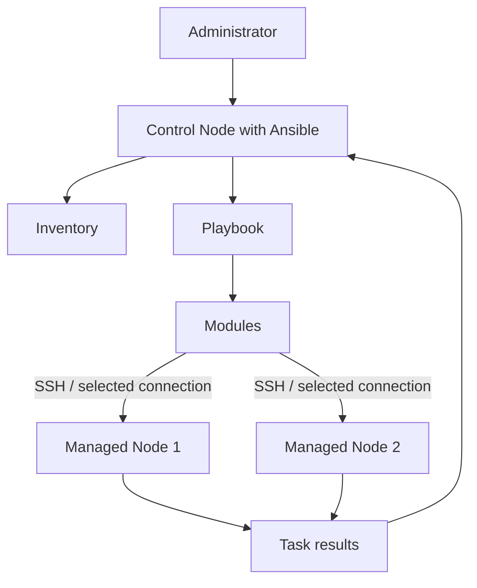

# Unit V — Introduction to Ansible

> **Syllabus unit:** Introduction to Ansible<br>
> **Course:** INT333 — DevOps Advance Configuration Management (Session 2026–27)

## 1. Learning objectives

After this unit, you should be able to explain Ansible and its relationship to configuration management, describe how it works and its architecture, discuss modern infrastructure management and the shift from shell scripts to Ansible, explain Ansible's relationship to Red Hat, install Ansible, create a basic inventory and understand its use with Vagrant.

## 2. Introduction to Ansible and configuration management

**Ansible** is an automation tool used for configuration management, application deployment and operational tasks. It commonly connects from a control node to managed nodes over SSH for Linux/Unix systems, without requiring a persistent agent on each managed node in the usual model.

Ansible automation is written in YAML playbooks. Tasks generally use modules that describe the intended operation, such as installing a package, managing a file or starting a service.

### Why Ansible?

- Human-readable automation using YAML.
- Agentless management for many common SSH-based Linux workflows.
- Reusable modules and roles.
- Inventory-based grouping of managed nodes.
- Declarative/idempotent behavior for many modules when used appropriately.
- Automation across configuration, deployment and administration tasks.

Not every Ansible task is automatically idempotent. A raw shell command may make changes every time it runs. Prefer purpose-built modules and test repeat execution.

## 3. How Ansible works

A typical Ansible run has:

1. A **control node** where Ansible is installed and a playbook is executed.
2. An **inventory** listing managed hosts and groups.
3. A **playbook** describing plays, targets, variables and tasks.
4. **Modules** that carry out specific actions on the target.
5. A **connection method**, commonly SSH for Linux targets.
6. Results returned to the control node.



For a localhost lab, Ansible can use a local connection. That is different from connecting to a separate server through SSH; the inventory and connection settings must match the actual target.

## 4. Modern infrastructure management

Modern environments contain multiple servers, virtual machines, containers, cloud resources and distributed applications. Manual configuration becomes difficult to reproduce and audit as environments grow.

Automation helps standardize recurring activities, but each tool has a scope:

- Terraform commonly manages infrastructure lifecycle.
- Puppet commonly enforces desired configuration through agents/catalogs.
- Ansible orchestrates tasks and configuration through inventories and playbooks.
- Docker packages/runs applications in containers.
- Nagios monitors operational health.

A well-designed environment uses tools together with clear ownership rather than letting several systems manage the same resource.

## 5. Ansible and Red Hat

Ansible originated as an open-source automation project and is associated with Red Hat, which acquired Ansible in 2015. Red Hat offers enterprise automation products and services built around Ansible technology, including Ansible Automation Platform. The open-source Ansible community project and enterprise offerings have different packaging, support and feature contexts.

For course learning, focus on core concepts—inventory, modules, playbooks, roles and execution—rather than assuming every enterprise feature is available in the community package.

## 6. Ansible architecture

Important components:

- **Control node:** runs Ansible commands and playbooks.
- **Managed node:** system being configured or operated on.
- **Inventory:** host and group definitions.
- **Modules:** units of work executed on targets.
- **Plugins:** extend Ansible behavior, such as connection, callback, lookup and inventory plugins.
- **Playbooks:** YAML files containing plays and tasks.
- **Facts:** information gathered about managed systems.
- **Roles:** reusable directory structures for organizing automation.

Ansible generally does not need a long-running agent on SSH-managed Linux hosts. The control node connects, transfers or executes the required module code, and gathers the result.

## 7. Infrastructure management: from shell scripts to Ansible

A shell script can automate a fixed sequence of commands. It may be appropriate for small local tasks, but as the number of hosts and variations grows, shell scripts often accumulate duplicated logic, fragile text parsing, implicit assumptions and weak reporting.

Ansible provides:
- Inventory and host grouping.
- Structured task definitions.
- Purpose-built modules.
- Variables and facts.
- Handlers and conditional execution.
- Reusable roles.
- Structured execution output.

| Shell script | Ansible playbook |
|---|---|
| Often imperative command sequence | Structured YAML plays and tasks |
| Host lists handled manually or externally | Inventory built into workflow |
| Idempotency must be implemented manually | Many modules support desired-state behavior |
| Error handling depends on script design | Task status, conditions, blocks and handlers |
| Reuse often requires scripting conventions | Roles, collections and variables support reuse |

Shell remains useful for small helper scripts, custom checks and operations where a script is the right abstraction. Ansible does not eliminate the need to understand the underlying operating system.

## 8. Installing Ansible

Installation depends on the operating system, Python environment and desired Ansible release. Inspect first:

```bash
cat /etc/os-release
python3 --version
ansible --version
apt-cache policy ansible
```

On Ubuntu, a distribution package may be available, but its version may differ from the latest upstream release. A Python virtual environment can isolate a project-specific installation where appropriate. Do not use `sudo pip` to modify the system-managed Python environment.

After installation:

```bash
ansible --version
ansible-doc -l | head
ansible-inventory --version
```

Check the installed version and available collections before using features from a newer release.

## 9. Creating a basic inventory file

An **inventory** identifies hosts and groups. It can be written in INI or YAML format.

Example INI inventory:

```ini
[web]
web1.example.test ansible_user=ubuntu
web2.example.test ansible_user=ubuntu

[local]
localhost ansible_connection=local
```

The hostnames above are examples and must be replaced with real lab targets before a remote connection is attempted.

Inspect inventory:

```bash
ansible-inventory -i inventory.ini --list
ansible-inventory -i inventory.ini --graph
```

Test connectivity to a configured host:

```bash
ansible -i inventory.ini all -m ping
```

The Ansible `ping` module tests Ansible connectivity and Python availability on the target; it is not an ICMP network ping.

## 10. Ad-hoc commands

An **ad-hoc command** runs a module against selected inventory hosts without creating a full playbook.

Examples:

```bash
ansible localhost -i 'localhost,' -c local -m ping
ansible localhost -i 'localhost,' -c local -m setup -a 'filter=ansible_distribution*'
```

Use ad-hoc commands for focused one-off operations. If the task must be repeatable, reviewed or reused, put it in a playbook.

## 11. Using Ansible with Vagrant: setup and usage

Vagrant automates the creation and management of development virtual machines. It can provide repeatable lab machines that Ansible then configures.

Conceptual workflow:

1. Install a supported virtualization provider and Vagrant.
2. Initialize a Vagrant project and define a base box.
3. Configure CPU, memory, networking and shared folders as needed.
4. Start the VM.
5. Obtain its connection details.
6. Create an Ansible inventory or use Vagrant's generated inventory/integration where available.
7. Run Ansible playbooks against the VM.

Typical Vagrant commands:

```bash
vagrant init
vagrant validate
vagrant up
vagrant status
vagrant ssh
vagrant halt
```

The exact Vagrantfile and Ansible integration syntax depend on the provider and Vagrant version. Virtual machines require disk and memory resources; on a 16 GB host, limit concurrent VMs and containers.

## 12. Quick revision questions

1. What is Ansible? State its major uses.
2. Explain how Ansible works from control node to managed node.
3. Define inventory, module, plugin, playbook and role.
4. Why is Ansible commonly described as agentless?
5. Explain the relationship between Ansible and Red Hat.
6. Compare shell scripts and Ansible playbooks.
7. How do you install and verify Ansible?
8. Write a basic INI inventory file.
9. What does the Ansible ping module test?
10. Explain how Vagrant and Ansible can be used together.

## 13. Practical connection

This unit supports practicals 11–12: Ansible installation, inventory creation, ad-hoc commands, and writing/executing basic playbooks. It also introduces the Vagrant environment named in the syllabus.

---

**Syllabus coverage:** Ansible introduction and configuration management; how Ansible works; modern infrastructure management; Ansible and Red Hat; architecture; shell scripts to Ansible; installation; basic inventory; Ansible with Vagrant.
